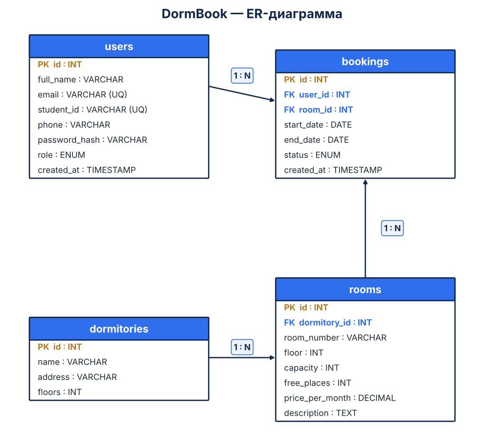

# DormBook — Жатақхана бөлмелерін брондау жүйесі

PHP және MySQL қолданып әзірленетін жеке оқу жобасы.

## 1. Жоба туралы

DormBook — студенттерге жатақханадан бөлмені онлайн броньдауға арналған веб-қосымша. Жүйе студенттерге жатақханалар мен бос бөлмелерді қарауға, бөлмені түрі, бағасы және бос орын саны бойынша іздеуге, сондай-ақ брондауға өтінім жіберуге мүмкіндік береді. Әкімші өтінімдерді қарап, оларды мақұлдайды немесе қабылдамайды.

**Жобаның мақсаты** — жатақханаға орналасу үдерісін кезексіз, жылдам әрі ашық ету.

## 2. Негізгі мүмкіндіктер

- **Тіркелу және авторизация:** студент аккаунт құрып (аты-жөні, email, студенттік ID, телефон), жүйеге кіреді.
- **Бөлмелерді қарау:** әр бөлменің нөмірі, қабаты, орын саны, бос орын саны және айлық бағасы көрсетіледі.
- **Іздеу және сүзгілеу:** жатақхана атауы, бөлме нөмірі, бөлме түрі (2/3/4 орындық) және бос орны бар-жоғы бойынша.
- **Бөлме брондау:** студент таңдаған бөлмеге кіру және шығу күнін көрсетіп, өтінім жібереді.
- **Жеке кабинет:** студент өз өтінімдерінің мәртебесін көреді (күтуде / мақұлданды / қабылданбады / бас тартылды) және күтудегі өтінімнен бас тарта алады.
- **Әкімші панелі:** бөлмелерді басқару (CRUD) және өтінімдерді мақұлдау.
- **Деректерді қорғау:** енгізілген ақпаратты тексеру және құпиясөзді хэштеп сақтау.

## 3. Технологиялар

- **Frontend:** HTML5, CSS3, JavaScript
- **Backend:** PHP
- **Database:** MySQL (PDO арқылы қосылу)
- **Жергілікті сервер:** XAMPP
- **Нұсқаларды басқару:** Git және GitHub

## 4. Беттер тізімі

1. `index.php` — басты бет
2. `rooms.php` — бөлмелер каталогы, іздеу/сүзгі және брондау формасы
3. `register.php` — тіркелу
4. `login.php` — жүйеге кіру
5. `profile.php` — жеке кабинет және «Менің брондауларым»
6. `logout.php` — жүйеден шығу
7. `admin.php` — әкімші панелі (келесі кезеңде)

## 5. Дерекқор құрылымы (MySQL — 4 кесте)

- **users** — пайдаланушылар: аты-жөні, email, студенттік ID, телефон, құпиясөз хэші, рөлі (student / admin).
- **dormitories** — жатақханалар: атауы, мекенжайы, қабат саны.
- **rooms** — бөлмелер: қай жатақханаға тиесілі, нөмірі, қабаты, орын саны, бос орын саны, айлық бағасы, сипаттамасы.
- **bookings** — брондаулар: қай студент, қай бөлме, кіру және шығу күні, мәртебесі.

## 6. ER-диаграмма

**Кестелер арасындағы байланыстар:**

- **dormitories → rooms (1:N):** бір жатақханада бірнеше бөлме болады.
- **users → bookings (1:N):** бір студент бірнеше брондау өтінімін жібере алады.
- **rooms → bookings (1:N):** бір бөлмеге бірнеше өтінім түсуі мүмкін.

**PK** — негізгі кілт, **FK** — сыртқы кілт, **UQ** — қайталанбайтын мән.

## 7. Қауіпсіздік

- Құпиясөздер `password_hash()` арқылы хэштеліп сақталады, `password_verify()` арқылы тексеріледі.
- SQL сұраныстары PDO арқылы параметрленген түрде (prepared statements) орындалады — SQL-инъекциядан қорғау.
- Пайдаланушы енгізген деректер серверде тексеріледі (email, телефон, күндер, құпиясөз ұзындығы).
- Экранға шығатын мәтін `htmlspecialchars()` арқылы өңделеді — XSS шабуылынан қорғау.
- Жеке кабинет пен брондау тек жүйеге кірген пайдаланушыға қолжетімді.

## 8. Апта бойынша орындалған жұмыс

- [x] **8-апта:** жоба жоспары, беттер тізімі, дерекқор құрылымы, ER-диаграмма және README.
- [x] **9-апта:** HTML, CSS және JavaScript қолданылған 3 адаптивті статикалық бет (`index.php`, `rooms.php`, `login.php`). Бөлмелерді JavaScript арқылы іздеу, мобильді мәзір.
- [ ] **10-апта:** `include`, `$_GET` және `$_POST` өңдеу.
- [ ] **11-апта:** дерекқор, PDO, аутентификация, сессиялар.
- [ ] **Келесі кезең:** әкімші панелі — бөлмелерді қосу/өңдеу/жою (CRUD) және өтінімдерді мақұлдау.

## 9. Жобаны іске қосу

1. XAMPP бағдарламасын ашып, **Apache** серверін іске қосу.
2. Жоба бумасын `C:\xampp\htdocs\dormbook` мекенжайында сақтау.
3. Браузерде `http://localhost/dormbook/` мекенжайын ашу.
4. Дерекқорды пайдаланатын функциялар (11-апта) қосылғаннан кейін MySQL қызметін іске қосып, `database.sql` файлын импорттау.
